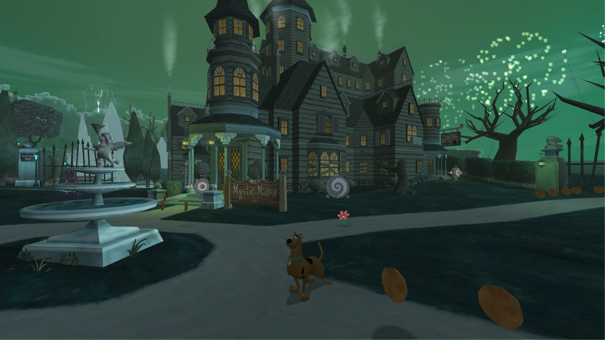
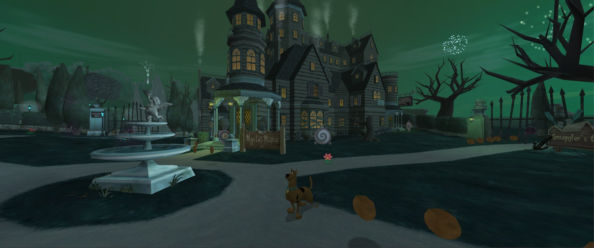
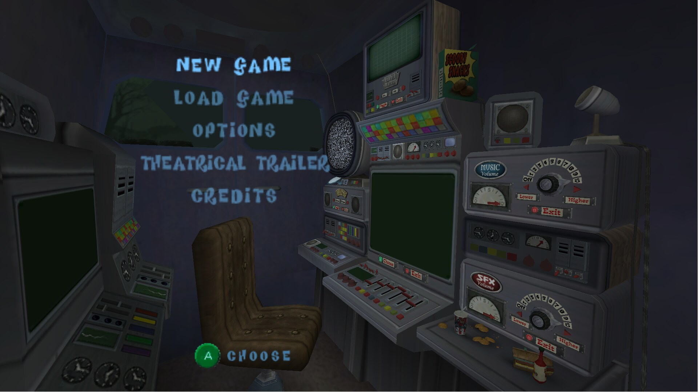
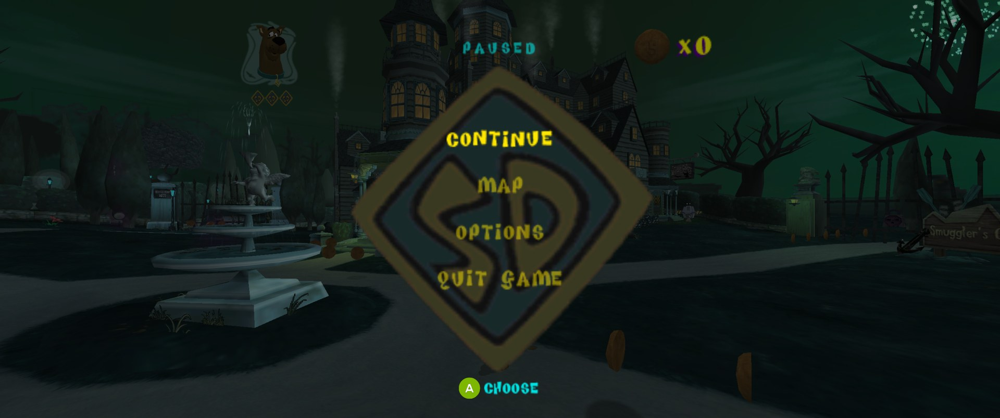
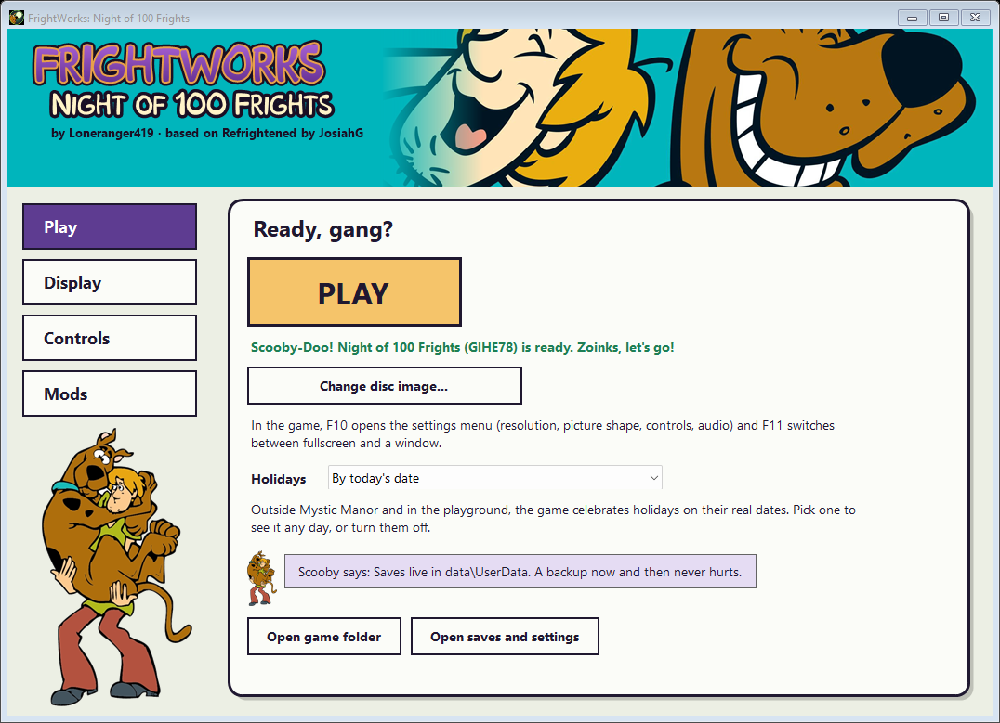

# FrightWorks: Night of 100 Frights

A statically recompiled PC port of **Scooby-Doo! Night of 100 Frights** (GameCube, 2002). The game's PowerPC code is
translated ahead of time to C++ with [WiiCompiled](https://github.com/patchzyy/Wiicompiled) and compiled into a Windows
program, so there is no CPU emulator; the console's graphics, audio and system calls are reimplemented underneath.

FrightWorks continues [Scooby-Doo: Refrightened](https://github.com/josiahg2502-glitch/Scooby-Doo-Refrightened) by JosiahG. This repository is the GameCube version;
ports of the other console versions may follow.



<p>
  
  
  
</p>

## Features

- Up to 4K, true widescreen (16:9, fill, cinematic 2.39:1) or original 4:3
- 30 or 60 fps, MSAA anti-aliasing, HDR
- Restored Creeper window animation in Mystic Manor's Mystery Machine courtyard
- Built-in HD texture pack (can be switched off)
- Gamepads and keyboard, remappable; button prompts match your Xbox, PlayStation or Nintendo controller
- GameCube memory-card saves
- Option to skip the intro movies; mods that replace game files or textures
- The game's holiday events follow the real date, or pick a holiday or turn them off on the launcher's **Play** page

**No game data is included.** You need your own disc image.

The courtyard animation reuses the retained GameCube textures and their original timing, keeping the
GameCube window colors. No Xbox image or imported assets are needed; existing nonempty material-map mods
are left unchanged.

## Playing

Requires Windows 10/11 (64-bit) and **Night of 100 Frights, GameCube USA v1.01 (GIHE78, revision 1)** as `.iso`,
`.gcm` or `.ciso`.

1. Unzip the [latest release](https://github.com/Loneranger419/FrightWorks-no100f-gc/releases/latest).
2. Open `FrightWorks.exe`, choose your disc image on the **Play** page, then press **PLAY**.

Settings are on the launcher's **Display** page and in game (**F10**). **F11** toggles fullscreen, **F2** saves a
screenshot to the `Screenshots` folder and **F1** opens this page in your browser. Saves, settings
and mods live in `data\UserData`; unzip a new release over the old folder to update.

Coming from Scooby-Doo: Refrightened? Unzip FrightWorks next to your old folder. On first start, the launcher offers
to copy your saves, settings, controls, mods and game files over; the old folder is left as it is.

**Version numbers** continue from Scooby-Doo: Refrightened. Its last release, v1.0.2, is the commit FrightWorks split
off from, so FrightWorks starts at v1.0.3.



## Building

Windows 10/11 x64 with Python 3 and Git. The build downloads its own toolchain into the repo.

```powershell
powershell -ExecutionPolicy Bypass -File tools\build-launcher.ps1
& "launcher\publish\FrightWorks.exe" --extract "C:\path\to\game.iso" Disc\DATA
powershell -ExecutionPolicy Bypass -File tools\build-no100f.ps1
powershell -ExecutionPolicy Bypass -File tools\package-scooby.ps1 -Zip
```

The game builds to `Play\`; the package goes to `dist\`. Packaging expects the HD texture pack in
`texture_pack\ScoobyHD` (not in git).

Tests, playtest sessions and the debug tools (dev menu, logs, scripted input): [`docs/testing.md`](docs/testing.md).

## Credits

- FrightWorks: Loneranger419
- Fright Wrangler, Mater of Mysteries, and Scooby Snack Technician - [BitsofBitsofBits](https://github.com/BitsofBitsofBitsofBits)
- Original port, [Scooby-Doo: Refrightened](https://github.com/josiahg2502-glitch/Scooby-Doo-Refrightened): JosiahG
- [WiiCompiled](https://github.com/patchzyy/Wiicompiled) by patchzyy and contributors (GPLv3); Aurora by Luke Street
  (MIT); other components in [`wiicompiled/THIRD-PARTY-NOTICES.md`](wiicompiled/THIRD-PARTY-NOTICES.md)
- HD texture pack by **dogerki**
  ([Dolphin forums](https://forums.dolphin-emu.org/Thread-scooby-doo-night-of-100-frights-hd-texture-pack-ai))
- Button prompts from [Kenney's Input Prompts](https://kenney.nl/assets/input-prompts) (CC0)
- Launcher font "Scooby Doo" by Lauren Ashpole ([FontSpace](https://www.fontspace.com/scooby-doo-font-f7039))

## License

GPLv3 ([`LICENSE`](LICENSE)); bundled components keep their own licenses. FrightWorks is a modified version of
Scooby-Doo: Refrightened by JosiahG, changed by Loneranger419 from 2026-10-31 on (the git history lists every change).

Not covered by the GPL (these stay under their owners' terms):

- `launcher/art/`, `launcher/frightworks.ico`, `launcher/frightworks-256.png`, `launcher/scooby.ico`: Scooby-Doo and
  Shaggy artwork, © Hanna-Barbera / Warner Bros.
- `launcher/title.ttf`: the "Scooby Doo" font by Lauren Ashpole, freeware; commercial use requires a donation
  ([FontSpace](https://www.fontspace.com/scooby-doo-font-f7039))
- `docs/`: screenshots of the game and the launcher

Scooby-Doo ™ & © Hanna-Barbera / Warner Bros. Night of 100 Frights © THQ / Warner Bros. Interactive, developed by
Heavy Iron Studios. Unofficial fan project, not affiliated with or endorsed by them. The repository contains no game
code or assets; the game's data is read from your own copy.
